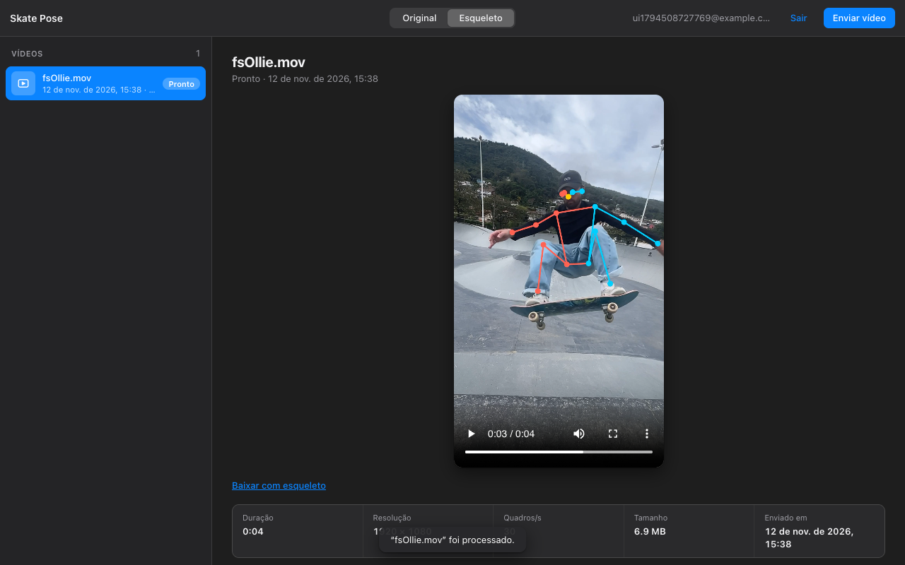
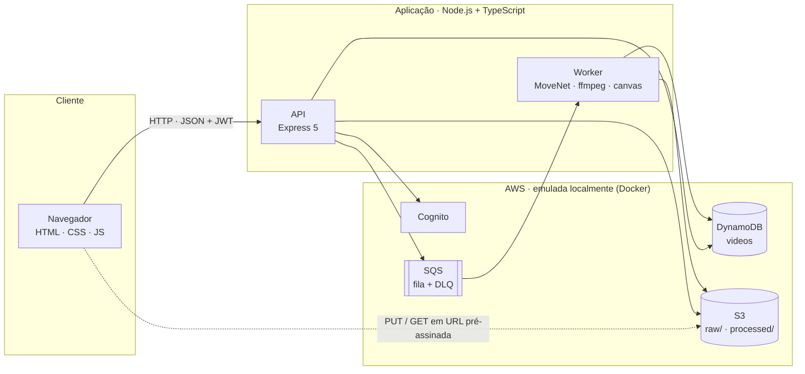
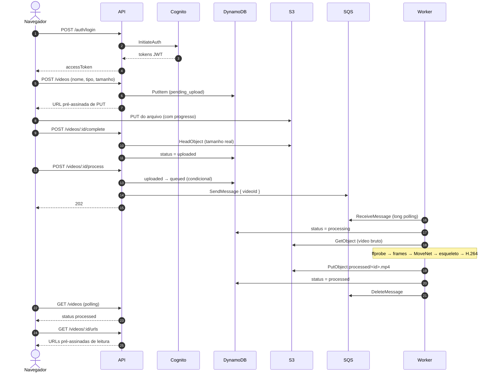
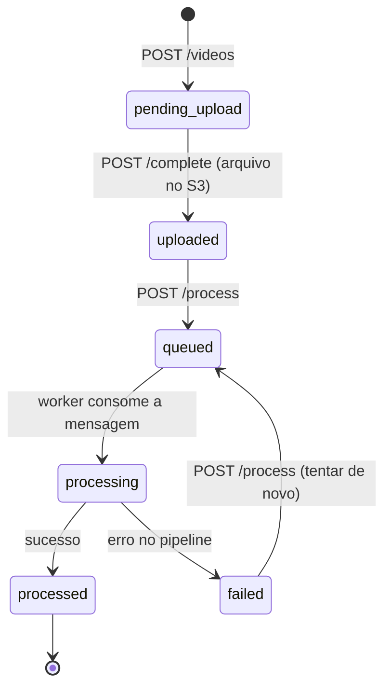

<div align="center">

# Skate Pose

**Envie um vídeo de skate e receba de volta o mesmo vídeo com o esqueleto de movimento desenhado sobre o corpo do skatista.**




</div>

---

## Sumário

- [Visão geral](#visão-geral)
- [Arquitetura](#arquitetura)
- [Stack](#stack)
- [Início rápido](#início-rápido)
- [Configuração](#configuração)
- [Referência da API](#referência-da-api)
- [Como o vídeo é processado](#como-o-vídeo-é-processado)
- [Modelo de dados](#modelo-de-dados)
- [Segurança](#segurança)
- [Scripts utilitários](#scripts-utilitários)
- [Estrutura do projeto](#estrutura-do-projeto)
- [Vídeo de arquitetura (Remotion)](#vídeo-de-arquitetura-remotion)
- [Solução de problemas](#solução-de-problemas)
- [Limitações conhecidas e próximos passos](#limitações-conhecidas-e-próximos-passos)
- [Assets](#assets)
- [Licença](#licença)

## Visão geral

O Skate Pose recebe vídeos de manobras, guarda o arquivo original no S3 e os metadados no DynamoDB, e processa o vídeo em segundo plano: um modelo de estimativa de pose (**MoveNet**, via TensorFlow.js) localiza as articulações de cada quadro, o esqueleto é desenhado sobre a imagem e o vídeo é remontado em H.264, mantendo o áudio original.

**O que o projeto entrega**

- Upload **direto para o S3** por URL pré-assinada, com barra de progresso, sem o arquivo passar pela API.
- **Processamento sob demanda**: o envio e o processamento são etapas separadas, disparadas pelo botão *Processar*.
- **Fila SQS** com *long polling*, nova tentativa automática e fila de erros (DLQ).
- **Autenticação com Cognito**: tokens JWT validados pela API (assinatura, emissor, expiração e `client_id`). Cada usuário só enxerga os próprios vídeos.
- **Worker separado da API**, para que o trabalho pesado de visão computacional não concorra com as requisições HTTP.
- **Interface web** minimalista em HTML, CSS e JavaScript puros, no estilo macOS, com modo escuro.
- **Tudo roda localmente** no [AWS Emulator](https://docs.aws.amazon.com/emulator/latest/userguide/what-is-service.html), sem conta nem custo na AWS.

> **Estado do projeto:** em desenvolvimento, validado em ambiente local (macOS, Apple Silicon). Veja [Limitações conhecidas](#limitações-conhecidas-e-próximos-passos) antes de usar em produção.

## Arquitetura



### Fluxo de ponta a ponta



> **Nota sobre o ambiente de desenvolvimento:** o emulador não responde ao *preflight* de CORS (devolve `501`) e usa certificado autoassinado, então o navegador não consegue falar com ele diretamente. Em desenvolvimento, a API expõe um proxy (`/_s3`) que apenas repassa as requisições de URL pré-assinada ao emulador. O proxy é desligado quando `NODE_ENV=production`; nesse caso as URLs apontam direto para o S3.

## Stack

| Camada | Tecnologias |
| --- | --- |
| Frontend | HTML, CSS e JavaScript puros (ES modules), `XMLHttpRequest` para progresso de upload |
| API | Node.js 24, Express 5, TypeScript (modo estrito), Zod, `jose` |
| AWS (emulado) | Cognito, DynamoDB, S3, SQS (AWS SDK for JavaScript v3) |
| Processamento | TensorFlow.js (`tfjs-node`) com MoveNet, ffmpeg/ffprobe, `@napi-rs/canvas` |
| Infra local | AWS Emulator em Docker |
| Documentação em vídeo | Remotion (React) |

## Início rápido

### Pré-requisitos

- **Node.js 24** (versão em que o projeto foi desenvolvido e testado)
- **Docker**
- **ffmpeg** e **ffprobe** no `PATH` (`brew install ffmpeg` no macOS)

### 1. Instalar as dependências

```bash
npm install
cp .env.example .env
```

### 2. Construir a imagem do emulador

O AWS Emulator não publica imagem pronta; ela é construída a partir do [`dockerfile`](dockerfile) do projeto.

```bash
docker build -f dockerfile -t aws-emulator .
```

> O `dockerfile` usa o pacote **`aarch64`** (Apple Silicon / ARM). Em máquinas x86, troque `aws-emulator-aarch64.rpm` por `aws-emulator-x86_64.rpm` na linha `ADD`. Usar o pacote errado faz o `rpm -i` falhar com dependências de `libc.so.6` não satisfeitas.

### 3. Subir o emulador

```bash
./run-emulator.sh          # porta padrão 9297
./run-emulator.sh 9300     # outra porta
REBUILD=1 ./run-emulator.sh  # força rebuild da imagem
```

O script constrói a imagem se ela não existir, cria `~/.aws/emulator` e inicia o container (limite de 2 GB de memória, porta publicada **somente em `127.0.0.1`**). Deixe esse terminal aberto. Ao parar com `Ctrl+C`, **todos os recursos emulados são perdidos**.

### 4. Apontar o ambiente para o emulador

Em **cada terminal** que for rodar a API, o worker ou o CLI:

```bash
source ./env-emulator.sh         # porta padrão 9297
```

O script define `AWS_ENDPOINT_URL`, as credenciais temporárias geradas pelo emulador, o certificado (`AWS_CA_BUNDLE`, `NODE_EXTRA_CA_CERTS`), região e flags necessárias. Use `source`, não execute o arquivo, senão as variáveis somem ao fim do script.

### 5. Iniciar a API e o worker

```bash
# terminal 2
source ./env-emulator.sh && npm run dev       # API em http://localhost:3000

# terminal 3
source ./env-emulator.sh && npm run worker    # consumidor da fila
```

No boot, a API cria automaticamente o bucket, a tabela do DynamoDB, as filas e o user pool do Cognito que faltarem. Sem o worker em execução, o vídeo é enviado normalmente, mas fica em **Na fila** indefinidamente.

### 6. Usar

Abra **http://localhost:3000**, crie uma conta (em desenvolvimento ela já nasce confirmada), arraste um vídeo para a janela e clique em **Processar**. Há um vídeo de exemplo em [`assets/fsOllie.mov`](assets/fsOllie.mov).

Para exercitar o fluxo completo sem a interface:

```bash
./test-upload.sh                                   # usa assets/fsOllie.mov
./test-upload.sh meu-video.mp4 http://localhost:3000
EMAIL=eu@teste.com PASSWORD='Passw0rd!x' ./test-upload.sh
```

O script cadastra/loga o usuário, confere que a rota sem token devolve `401` e percorre o fluxo de upload em quatro passos (registrar, enviar pela URL pré-assinada, confirmar e processar). Em seguida acompanha o status até `processed` ou `failed`. Precisa do worker rodando.

## Configuração

Variáveis lidas de `.env` (veja [`.env.example`](.env.example)) e validadas com Zod na inicialização.

| Variável | Padrão | Descrição |
| --- | --- | --- |
| `PORT` | `3000` | Porta HTTP da API |
| `NODE_ENV` | `development` | `production` desliga o proxy `/_s3`, o auto-confirm de cadastro e a criação automática do bucket e do user pool (a tabela e as filas ainda são criadas se não existirem) |
| `S3_BUCKET` | `skate-videos` | Bucket de vídeos (`raw/` e `processed/`) |
| `S3_FORCE_PATH_STYLE` | `true` | Necessário com endpoint IP (emulador) |
| `DDB_TABLE` | `videos` | Tabela de metadados |
| `SQS_QUEUE_NAME` | `video-processing` | Fila de processamento |
| `SQS_DLQ_NAME` | `video-processing-dlq` | Fila de mensagens com falha |
| `SQS_MAX_RECEIVE_COUNT` | `3` | Tentativas antes de ir para a DLQ |
| `COGNITO_POOL_NAME` | `skate-pose` | Nome do user pool e do app client (criados em dev) |
| `COGNITO_USER_POOL_ID` | – | **Obrigatório em produção** |
| `COGNITO_CLIENT_ID` | – | **Obrigatório em produção** |
| `MAX_UPLOAD_MB` | `500` | Tamanho máximo de um vídeo. **No emulador o teto real é menor:** ele guarda no máximo 64 MiB de objetos por bucket (veja [Solução de problemas](#solução-de-problemas)) |
| `WORK_DIR` | `./tmp` | Diretório temporário do worker |
| `POSE_MODEL` | `thunder` | `thunder` (1 pessoa, mais preciso), `lightning` (1 pessoa, mais rápido) ou `multipose` (até 6) |
| `POSE_MIN_SCORE` | `0.3` | Confiança mínima de um ponto para ser desenhado |

Endpoint, credenciais e certificado da AWS vêm das variáveis padrão do SDK (`AWS_ENDPOINT_URL`, `AWS_CA_BUNDLE`, `AWS_REGION`, `AWS_SHARED_CREDENTIALS_FILE` etc.), definidas por `env-emulator.sh`. Para usar a AWS real, basta não carregar esse script e fornecer credenciais e os IDs do Cognito.

## Referência da API

Todas as rotas `/videos` exigem `Authorization: Bearer <accessToken>`. Erros seguem o formato `{ "error": "mensagem" }`; falhas de validação incluem também `issues`.

### Autenticação

| Método | Rota | Corpo | Resposta |
| --- | --- | --- | --- |
| `POST` | `/auth/signup` | `{ email, password }` | `201` `{ confirmed }` |
| `POST` | `/auth/confirm` | `{ email, code }` | `204` |
| `POST` | `/auth/login` | `{ email, password }` | `{ accessToken, idToken, refreshToken, expiresIn }` |
| `POST` | `/auth/refresh` | `{ refreshToken }` | `{ accessToken, idToken, expiresIn }` |

A senha precisa ter ao menos 8 caracteres. Em desenvolvimento o cadastro é confirmado automaticamente, já que o emulador não envia e-mail; em produção vale o código por e-mail via `/auth/confirm`.

### Vídeos

| Método | Rota | Descrição | Sucesso |
| --- | --- | --- | --- |
| `POST` | `/videos` | Registra o vídeo e devolve a URL pré-assinada de PUT | `201` |
| `POST` | `/videos/:id/complete` | Confirma no S3 que o arquivo chegou | `200` |
| `POST` | `/videos/:id/process` | Enfileira o processamento | `202` |
| `GET` | `/videos?limit=20&cursor=…` | Lista os vídeos do usuário, mais recentes primeiro | `200` |
| `GET` | `/videos/:id` | Detalhes e status | `200` |
| `GET` | `/videos/:id/urls` | URLs pré-assinadas de leitura (`raw`, `processed`) | `200` |
| `GET` | `/health` | Verificação de saúde (sem autenticação) | `200` |

**Códigos de erro comuns:** `400` validação · `401` token ausente/inválido · `404` vídeo inexistente ou de outro usuário · `409` status não permite a operação, ou arquivo ainda não está no S3 · `413` arquivo acima de `MAX_UPLOAD_MB` · `415` tipo que não é vídeo.

### Exemplo com `curl`

```bash
API=http://localhost:3000

# 1) cadastro e login
curl -s -X POST $API/auth/signup -H 'Content-Type: application/json' \
  -d '{"email":"eu@exemplo.com","password":"Passw0rd!x"}'
TOKEN=$(curl -s -X POST $API/auth/login -H 'Content-Type: application/json' \
  -d '{"email":"eu@exemplo.com","password":"Passw0rd!x"}' | sed -n 's/.*"accessToken":"\([^"]*\)".*/\1/p')

# 2) registrar o vídeo -> devolve { video, upload: { url, headers, method } }
curl -s -X POST $API/videos -H "Authorization: Bearer $TOKEN" -H 'Content-Type: application/json' \
  -d '{"fileName":"fsOllie.mov","contentType":"video/quicktime","sizeBytes":6894949}'

# 3) enviar o arquivo para a URL devolvida (upload.url), com o mesmo Content-Type
curl -X PUT "$API<upload.url>" -H 'Content-Type: video/quicktime' --data-binary @assets/fsOllie.mov

# 4) confirmar e processar
curl -s -X POST $API/videos/<id>/complete -H "Authorization: Bearer $TOKEN"
curl -s -X POST $API/videos/<id>/process  -H "Authorization: Bearer $TOKEN"
```

> Em desenvolvimento, `upload.url` é um caminho relativo (`/_s3/...`); em produção é a URL absoluta do S3. O [`test-upload.sh`](test-upload.sh) automatiza todo esse fluxo.

## Como o vídeo é processado

O worker consome a fila e, para cada mensagem, executa o pipeline em [`src/services/processing/pipeline.ts`](src/services/processing/pipeline.ts):

1. **Download** do vídeo bruto do S3 para um diretório temporário.
2. **`ffprobe`**: duração, resolução e quadros por segundo. A resolução considera a **rotação** gravada no arquivo (vídeos de celular), então um vídeo vertical é reportado como vertical.
3. **`ffmpeg`**: extração dos quadros em JPEG.
4. **MoveNet** (TensorFlow.js): estimativa das articulações de cada quadro, com suavização e rastreamento temporal.
5. **Renderização**: ossos e articulações desenhados com `@napi-rs/canvas` (lado esquerdo em ciano, direito em vermelho), apenas para pontos acima de `POSE_MIN_SCORE`.
6. **`ffmpeg`**: remontagem em H.264 (CRF 20, `yuv420p`) reaproveitando o áudio original.
7. **Upload** para `processed/<id>.mp4` e atualização do status.

Para o clipe de exemplo (1080p, 4,7 s, 141 quadros), o fluxo completo levou cerca de 13 s em um Mac com Apple Silicon (medição única, sem pretensão de benchmark). A primeira execução baixa o modelo MoveNet da internet; as seguintes usam o cache.

**Resiliência da fila:** *visibility timeout* de 300 s, estendido por *heartbeat* a cada 120 s enquanto o vídeo processa; *long polling* de 20 s; após `SQS_MAX_RECEIVE_COUNT` falhas a mensagem vai para a DLQ. O worker descarta mensagens de vídeos inexistentes ou em status que não permite processar, o que torna a entrega repetida idempotente. A transição `uploaded|failed → queued` é **condicional no DynamoDB**, então um clique duplo não enfileira o mesmo vídeo duas vezes.

## Modelo de dados

Tabela única `videos` (DynamoDB, cobrança sob demanda):

| Chave | Atributos |
| --- | --- |
| **Partição:** `id` (UUID) | `ownerId`, `originalName`, `mimeType`, `sizeBytes`, `rawKey`, `processedKey`, `status`, `errorMessage`, `durationSec`, `width`, `height`, `fps`, `createdAt`, `updatedAt` |
| **GSI `byOwner`:** `ownerId` + `createdAt` | Lista os vídeos de um usuário do mais recente para o mais antigo |

O objeto de resposta da API omite `ownerId`, `rawKey` e `processedKey` (chaves internas) e expõe `hasProcessed`.



## Segurança

- **Validação de JWT na API:** assinatura RS256 verificada contra o JWKS do Cognito, mais emissor, expiração, `token_use = access` e `client_id`. O conjunto de chaves é cacheado e recarregado se o `kid` não for encontrado.
- **Isolamento por usuário:** consultar o vídeo de outro usuário devolve `404`, não `403`, para não revelar que o recurso existe.
- **URLs pré-assinadas** expiram em 15 minutos. Elas **não limitam o tamanho** do arquivo; por isso `/complete` confere o tamanho real com `HeadObject` e remove o objeto se passar do limite.
- **Cognito:** mensagens de usuário inexistente e de senha errada são ambas `401`.
- **Proxy `/_s3` (somente desenvolvimento):** restrito ao bucket configurado, aos métodos `GET`, `HEAD` e `PUT`, e desligado em produção. Não autentica por conta própria: a autorização é a assinatura da URL, validada pelo emulador.
- **Emulador:** a porta é publicada apenas em `127.0.0.1`. O emulador **não avalia políticas IAM**, então não serve para testar segurança de permissões.
- **Segredos:** `.env` está no `.gitignore`. As credenciais do emulador são temporárias e regeneradas a cada execução.

## Scripts utilitários

| Comando | Descrição |
| --- | --- |
| `npm run dev` | API com recarga automática |
| `npm run worker` | Worker com recarga automática |
| `npm run inspect` | "Painel" de terminal: itens do DynamoDB, profundidade da fila e da DLQ, usuários do Cognito (o emulador não tem interface gráfica) |
| `npm run typecheck` | Verificação de tipos (`tsc --noEmit`) |
| `npm run build` / `npm start` / `npm run start:worker` | Compila e executa a versão de produção |
| `./run-emulator.sh [porta]` | Constrói e executa o emulador em Docker |
| `source ./env-emulator.sh [porta]` | Configura o shell para usar o emulador |
| `./test-upload.sh [arquivo] [url]` | Teste de ponta a ponta pela API |

## Estrutura do projeto

```text
.
├── assets/                       # vídeo de exemplo e captura da interface
│   ├── fsOllie.mov
│   └── interface.png
├── public/                       # interface web (servida pela própria API)
│   ├── index.html · styles.css
│   └── api.js · app.js           # cliente da API, sessão, upload com progresso
├── src/
│   ├── server.ts · app.ts        # bootstrap e montagem do Express
│   ├── worker.ts                 # consumidor da fila SQS
│   ├── config/                   # variáveis de ambiente (Zod) e clientes AWS
│   ├── infra/                    # criação idempotente de tabela, filas e user pool
│   ├── routes/ · controllers/    # camada HTTP
│   ├── services/
│   │   ├── video.service.ts      # regras de upload, confirmação e processamento
│   │   ├── auth.service.ts · jwt.service.ts
│   │   ├── storage.service.ts · queue.service.ts
│   │   └── processing/           # pipeline, ffmpeg, MoveNet e renderização do esqueleto
│   ├── repositories/             # acesso ao DynamoDB
│   ├── middlewares/              # autenticação, erros e proxy de S3 (dev)
│   ├── scripts/inspect.ts
│   └── utils/ · types/
├── architecture-video/           # animação da arquitetura (Remotion)
├── dockerfile                    # imagem do AWS Emulator
├── run-emulator.sh · env-emulator.sh · test-upload.sh
└── .env.example
```

## Vídeo de arquitetura (Remotion)

A pasta [`architecture-video/`](architecture-video) contém uma animação *low poly* de cerca de 71 s que explica a arquitetura e o fluxo de envio, passo a passo. Ela é um projeto independente, com `package.json` próprio.

```bash
cd architecture-video
npm install
npm run studio     # editor/preview interativo
npm run render     # gera out/architecture.mp4 (1080p, 30 fps)
```

Os passos, tempos e textos ficam em [`architecture-video/src/data.ts`](architecture-video/src/data.ts). O diretório `out/` não é versionado.

A narração em áudio é opcional e **local**: foi gerada com um modelo Qwen3-TTS executado na própria máquina, a partir de uma referência de voz privada que não faz parte deste repositório (a pasta `narration/` é ignorada pelo Git por conter áudio derivado dessa voz).

## Solução de problemas

| Sintoma | Causa e solução |
| --- | --- |
| `self-signed certificate` / `DEPTH_ZERO_SELF_SIGNED_CERT` | O processo subiu sem as variáveis do emulador. Rode `source ./env-emulator.sh` **no mesmo terminal** e reinicie a API/worker (o Node lê o certificado só na inicialização). |
| `NoSuchBucket` | O emulador foi reiniciado e perdeu os recursos. Reinicie a API; ela recria o bucket. |
| Vídeo parado em **Na fila** | O worker não está rodando. Inicie `npm run worker` com as variáveis do emulador carregadas. |
| `rpm … is needed by aws-emulator-…x86_64` no build da imagem | Pacote de arquitetura errada. Em Apple Silicon use `aarch64` no `dockerfile`. |
| `util.isNullOrUndefined is not a function` | `@tensorflow/tfjs-node` 4.x usa funções removidas do Node 23+. O projeto aplica um *shim* em [`src/utils/node-compat.ts`](src/utils/node-compat.ts); ele precisa ser o primeiro import de quem carrega o TensorFlow. |
| `501 Not Implemented` ao falar com o emulador | A operação ainda não é suportada por ele (o emulador devolve `501` de forma explícita). |
| Upload falha com `HTTP 400` e `… past the 67108864 bytes this emulator keeps per bucket` | O emulador limita cada bucket a **64 MiB** de objetos (soma de `raw/` e `processed/`). Cada vídeo processado ocupa o original **mais** a versão com esqueleto. Libere espaço reiniciando o emulador (apaga tudo) ou removendo objetos; use clipes curtos nos testes. Na AWS real esse limite não existe. |
| Conta, vídeos e filas sumiram | O emulador guarda tudo em memória; reiniciar apaga tudo. Crie a conta novamente. |

## Limitações conhecidas e próximos passos

**Limitações**

- **Ambiente efêmero:** o AWS Emulator mantém tudo em memória e perde os dados ao parar. Ele não foi pensado para produção nem para carga prolongada.
- **Teto de 64 MiB por bucket no emulador:** mesmo com `MAX_UPLOAD_MB=500`, a soma de todos os objetos do bucket não pode passar disso em desenvolvimento. A interface mostra a mensagem do S3 quando isso acontece.
- **Caminhos ainda não exercitados em teste:** a entrega à DLQ após falhas repetidas e a extensão do *visibility timeout* pelo *heartbeat* (que só dispara após 2 minutos de processamento) não foram testadas.
- **Qualidade da pose:** com o skatista pequeno ou distante no quadro, o MoveNet fica menos preciso. `multipose` ou um recorte automático da região do skatista podem ajudar.
- **Sessão no navegador:** os tokens ficam em `localStorage`, o que é aceitável em desenvolvimento, mas em produção convém migrar para cookies `HttpOnly`.
- **Sem exclusão de vídeos** e sem limite de requisições (*rate limiting*).
- **Dependências:** o `npm audit --omit=dev` aponta 4 vulnerabilidades (1 crítica, 3 altas), todas transitivas do `@tensorflow/tfjs-node` (`tar`, `@mapbox/node-pre-gyp` e `adm-zip`). Pelo que foi avaliado, essas bibliotecas atuam na instalação do binário nativo, não no conteúdo enviado pelos usuários, mas vale reavaliar a cada versão. **Não rode `npm audit fix --force`**: a "correção" sugerida instala o `tfjs-node@0.1.11`, que quebra o projeto.
- **Plataformas:** validado em macOS com Apple Silicon. Linux e Windows não foram testados.

**Próximos passos sugeridos**

- Infraestrutura como código (Terraform ou CDK) para aplicar a mesma arquitetura na AWS real.
- API e worker em contêineres (ECS Fargate), com o worker em instâncias de maior memória.
- Endpoint de exclusão e política de retenção de objetos.
- Testes automatizados (unitários e de integração contra o emulador) e pipeline de CI.
- Recorte automático do skatista antes da estimativa de pose.

## Assets

| Arquivo | Descrição |
| --- | --- |
| [`assets/fsOllie.mov`](assets/fsOllie.mov) | Clipe de exemplo de um ollie (1080p gravado na vertical, 4,7 s, 30 fps, 6,6 MB), usado como entrada padrão do `test-upload.sh` |
| [`assets/interface.png`](assets/interface.png) | Captura da interface com um vídeo já processado |

## Licença

O código deste repositório é distribuído sob a **[Licença MIT](LICENSE)**. Em resumo: você pode usar, copiar, modificar e distribuir o código, inclusive comercialmente, desde que mantenha o aviso de copyright e a licença.

**Isenção de garantia e de responsabilidade.** O software é fornecido **"como está" (*as is*), sem garantia de qualquer tipo**, expressa ou implícita, incluindo adequação a uma finalidade específica. Os autores não respondem por reclamações, danos ou perdas decorrentes do uso do software, inclusive perda de dados, custos de infraestrutura na AWS e resultados da estimativa de pose. Isso vale em especial por este ser um projeto em desenvolvimento, validado apenas em ambiente local (veja [Limitações conhecidas](#limitações-conhecidas-e-próximos-passos)). O texto em inglês do arquivo [`LICENSE`](LICENSE) é o que vale juridicamente; o resumo acima é só uma explicação.

> Este aviso não constitui aconselhamento jurídico. Os efeitos de uma isenção de responsabilidade dependem da legislação aplicável. Em caso de dúvida, consulte um advogado.

**O que não está coberto pela licença MIT**

- **Conteúdo em [`assets/`](assets):** o vídeo e a captura de tela são materiais de demonstração, e todos os direitos sobre eles são reservados. Não os reutilize sem autorização, em especial por mostrarem uma pessoa real.
- **Dependências e ferramentas de terceiros**, cada uma com a sua licença: TensorFlow.js e o modelo MoveNet, o AWS SDK, Express, ffmpeg (executado como programa externo, não distribuído aqui), o **AWS Emulator** (baixado pelo `dockerfile`; confira os termos dele) e o **Remotion** (usado em `architecture-video/`, com licença própria: verifique os termos antes de uso comercial).
- **Marcas:** AWS, Amazon Cognito, DynamoDB, S3 e SQS são marcas da Amazon.com, Inc. ou de suas afiliadas. Este projeto é independente e não é afiliado nem endossado pela AWS.
